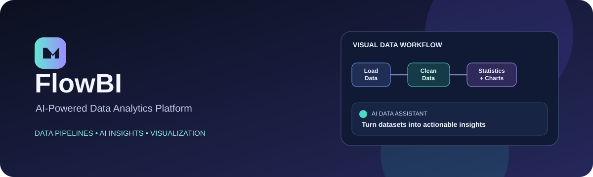

# FlowBI — AI-Powered Data Analytics Platform

  

  <b>Upload data. Build visual workflows. Explore insights with AI.</b> 
  A web-based analytics platform for data preparation, statistical summaries, visualizations, and natural-language dataset exploration.

  <a href="https://flow-bi.vercel.app/"><strong>🚀 Open Live Demo</strong></a>

---

## ✨ Features

- **CSV and Excel upload** — upload datasets and preview tabular data.
- **Data cleaning** — handle missing values and remove duplicate records.
- **Visual pipeline builder** — connect data-processing steps in a node-based workflow.
- **Statistical summaries** — inspect dataset dimensions and numerical summaries.
- **Data visualization** — explore processed data with charts.
- **LLM-powered data assistant** — ask questions about a dataset in natural language.
- **Analytics dashboard** — review dataset and processing information.
- **Dockerized setup** — containerization support for a more reproducible development/deployment workflow.

## 🖥️ Live Application

**Live demo:** https://flow-bi.vercel.app/

Explore the deployed application to see the current UI and available functionality. Feature availability may vary with the deployed version and configured services.

## 🧰 Technology Stack

| Area | Technologies |
| --- | --- |
| Frontend | React, Vite |
| Backend / API | Python, FastAPI |
| Data storage | PostgreSQL |
| AI integration | LLM-powered assistant |
| Data processing | Python data-processing workflows |
| Deployment / packaging | Vercel (frontend), Docker |

## 🔄 Example Workflow

1. Upload a CSV or Excel dataset.
2. Preview the data and review its structure.
3. Build a pipeline using steps such as loading data, handling missing values, removing duplicates, and generating statistics.
4. Run the workflow and review the processed output and charts.
5. Ask the AI assistant questions about the dataset.

## 📸 Screenshots

For the latest interface, visit the [live demo](https://flow-bi.vercel.app/).

Suggested screenshots to add:
- Dashboard and dataset overview
- Dataset preview and data insights
- Visual pipeline builder and execution results
- AI assistant answering dataset-specific questions

## 🎯 Project Goal

FlowBI brings data preparation, visual processing workflows, analytics, and AI-assisted exploration together in one application. The aim is to make common data-analysis tasks easier to follow without requiring every step to be written manually.

## 🛣️ Potential Improvements

- Add more configurable transformation nodes.
- Expand chart types and export options.
- Improve validation, error handling, and pipeline observability.
- Add richer dataset history and user-level data management.
- Improve AI response grounding and display the data evidence behind answers.

## 👨‍💻 Developer

**Krishna Gupta**  
GitHub: [@krishna6391824655-eng](https://github.com/krishna6391824655-eng)

## 📄 License

No license information is currently stated in this README. Add a license file if you intend to define permissions for reuse and distribution.
